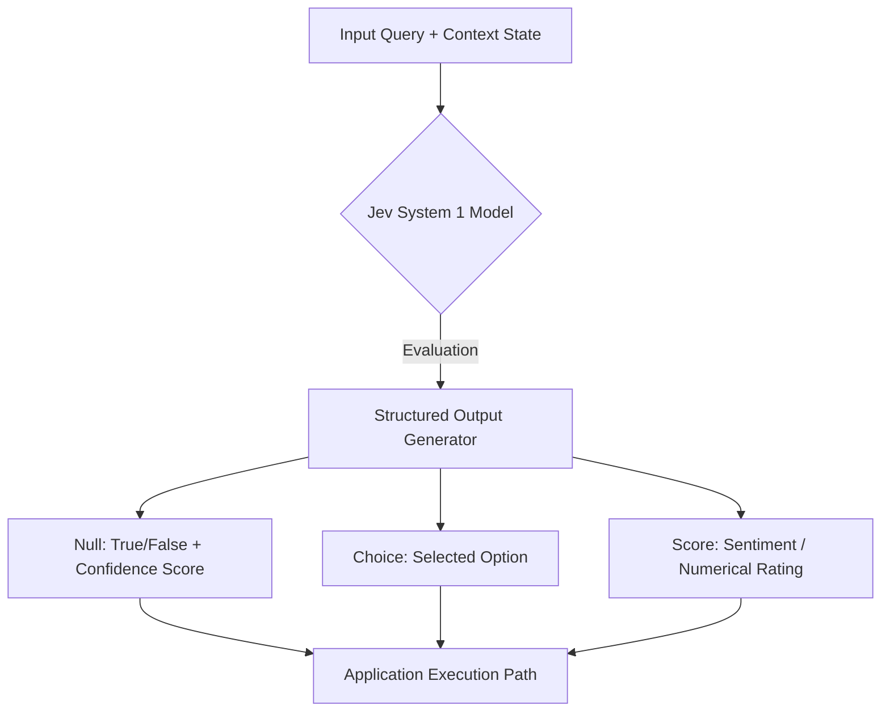
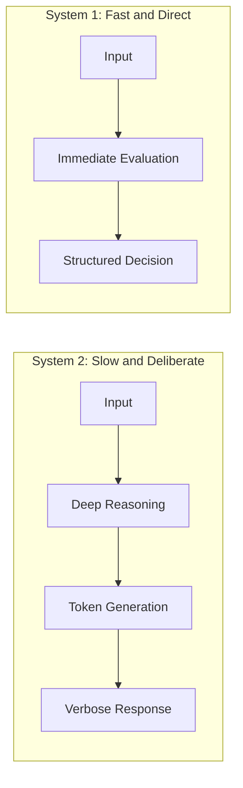
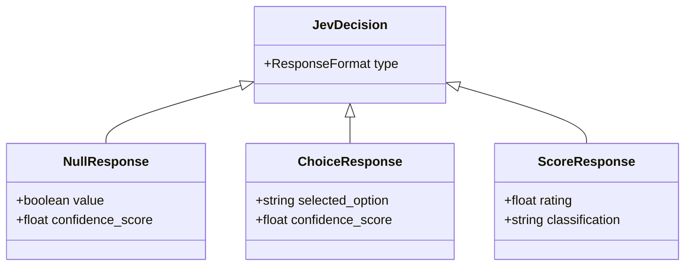
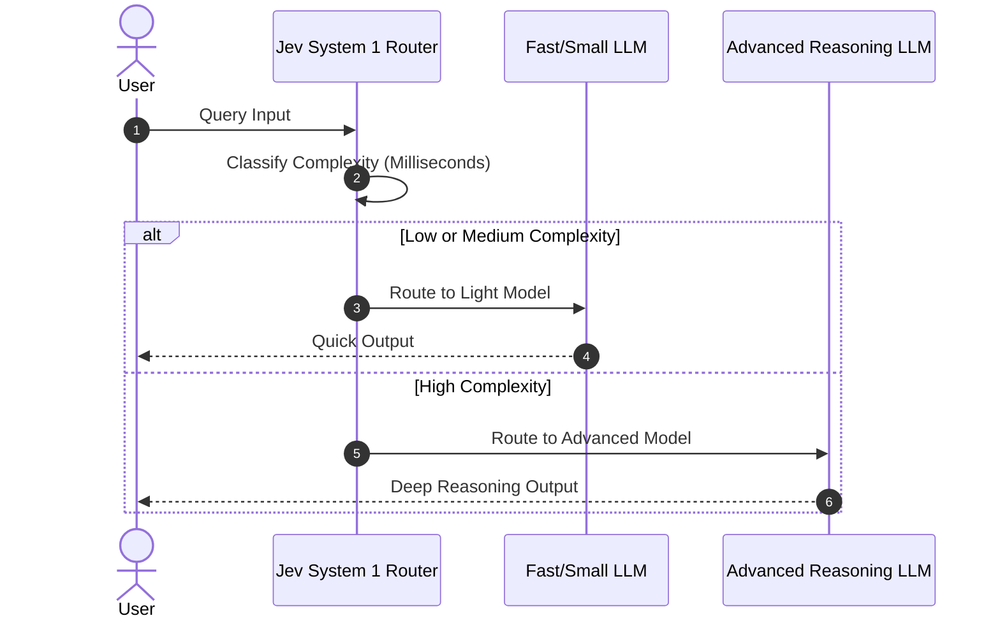

# Research Notes: Decision Models and System 1 AI Architectures

## Executive Summary

Jev shifts artificial intelligence design away from natural language generation toward deterministic decision execution. Operating as a low latency logic primitive within software pipelines, Jev eliminates conversational output overhead to maximize throughput, minimize operational costs, and execute rapid evaluations.

## Technical Definition and Core Mechanics

* Purpose built architecture: Tailored exclusively for automated classification, logic evaluation, and program routing instead of open ended dialogue or web synthesis.
* Input and output paradigm: Accepts structured inputs containing questions and context states, returning strict machine readable decisions rather than verbose text.
* Tool and interface limitations: Lacks web search capabilities, external tool execution, and speech synthesis by design.
* Ecosystem counterparts: OpenAI Decisions API, Cloudflare Clef, and Ollama Tev or Nimble local models.

### System Dataflow Architecture

## Cognitive Framework: System 1 versus System 2 Models

Jev adapts Daniel Kahneman cognitive architecture principles into runtime environments.

* System 2 Models (ChatGPT, Claude): Slow, deliberate, multi-step reasoning generating natural language tokens with high latency and high cost.
* System 1 Models (Jev, Clef): Fast, automatic classification producing structured decisions with low latency and minimal overhead.

## Output Response Types

Jev restricts output interfaces to three schema formats to maintain deterministic pipeline execution:

* Null: Evaluates binary conditions (True or False) with statistical confidence metrics.
* Choice: Classifies inputs against predefined multiple choice options.
* Score: Measures sentiment, strength, or scalar properties across a normalized scale.

## Specialized Workflows and Practical Implementations

### Dynamic Model Routing

Integrating Jev prior to downstream model invocation prevents resource waste by selecting the minimum required computational capability.

### Real Time Tracking Workflow

## Comparative Performance and System Trade Offs

* Custom machine learning classifiers require dedicated training datasets and engineering maintenance for new query contexts.
* Jev functions as a general purpose zero-shot classifier, accepting arbitrary contextual prompts instantly while matching classifier execution speeds.
* Cloud models deliver higher classification accuracy, while local open weight models provide zero API cost and data privacy.
